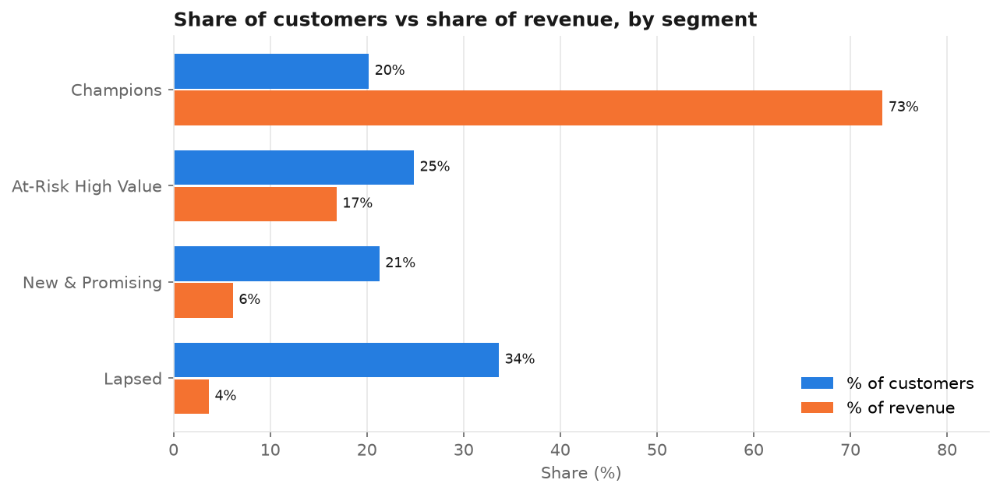
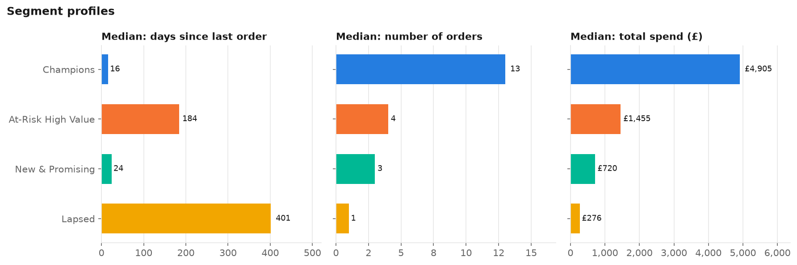

# Customer Segmentation for an Online Retailer

**Business question:** Which customers are worth the most, and how should marketing treat each group differently?

**Approach:** RFM (Recency, Frequency, Monetary) scoring and k-means clustering on the
[UCI Online Retail II](https://archive.ics.uci.edu/dataset/502/online+retail+ii) dataset:
about 1 million transactions from a UK online gift retailer, Dec 2009 to Dec 2011.

**Deliverable:** customer segments with profiles and a targeting plan for each, written
automatically to `outputs/segmentation_report.md`.

## Results

After cleaning, **5,852 customers** were grouped into **4 segments**. k = 4 had the best silhouette
score (0.361) of the options from 3 to 6.

| Segment | % of customers | % of revenue | Median days since last order | Median orders | Median spend |
|---|---|---|---|---|---|
| Champions | 20% | **73%** | 16 | 13 | £4,905 |
| At-Risk High Value | 25% | 17% | 184 | 4 | £1,455 |
| New & Promising | 21% | 6% | 24 | 3 | £720 |
| Lapsed | 34% | 4% | 401 | 1 | £276 |

**What this means for marketing**

- **Champions** (1 in 5 customers) bring in nearly three-quarters of revenue. Protect them with
  VIP treatment, early access to seasonal ranges and volume pricing rather than blanket discounts.
- **At-Risk High Value** customers account for 17% of revenue but haven't ordered in about six months.
  This is the biggest win-back opportunity: personal outreach and a reason to return.
- **New & Promising** customers bought recently but spend little. Use onboarding journeys and
  second-order incentives to turn them into repeat buyers.
- **Lapsed** customers are a third of the base but only 4% of revenue. Give them one low-cost
  reactivation campaign, then move them to low-frequency sends.

The full profiles and targeting plan are in [`outputs/segmentation_report.md`](outputs/segmentation_report.md).





## Quick start

```bash
pip install -r requirements.txt
# download online_retail_II.xlsx from the UCI link above into data/
python run_pipeline.py
```

Reading the Excel file takes a few minutes the first time because it has two large sheets.
Saving it once as CSV and running `python run_pipeline.py --input data/online_retail_II.csv` is faster.
Use `--k 4` (or any number) to override the automatic choice of cluster count.

## Project structure

```
run_pipeline.py          one command, runs everything
src/
  config.py              paths, parameters, chart colours
  data_prep.py           load + clean (duplicates, missing IDs, cancellations, non-product codes)
  rfm.py                 customer table, RFM quintile scores, rule-based RFM segments, Pareto stats
  clustering.py          log + standardise, choose k (elbow / silhouette / Davies-Bouldin), k-means, naming
  profiling.py           segment profiles + marketing playbook per segment
  report.py              charts + markdown report
tests/make_synthetic_data.py   fake data with the same schema, for testing without the download
outputs/                 generated: CSVs, figures/, segmentation_report.md
```

## Method

1. **Cleaning.** Remove duplicate lines, rows with no Customer ID, non-product codes
   (postage, bank charges, manual adjustments) and zero/negative quantity or price.
   Cancellations (invoices starting with `C`) are set aside and used for a return-rate feature.
2. **RFM.** For each customer: days since last purchase, number of distinct invoices, total spend.
   The snapshot date is the day after the last transaction.
3. **Scoring.** Each metric is split into quintiles (1-5). Customers are mapped to the classic RFM
   grid (Champions, Loyal, At Risk, Hibernating...), which acts as a benchmark.
4. **Clustering.** RFM is log-transformed (heavy right skew) and standardised, then k-means is run for
   k = 2-10. The pipeline picks the best silhouette score between k = 3 and 6. k = 2 only separates
   good from bad customers, and more than 6 segments is more programmes than a team can run.
5. **Profiling and targeting.** Clusters are ranked by median spend, named from their average R and F/M
   scores, profiled (size, revenue share, order value, tenure, return rate, UK share) and given a
   targeting plan: objective, actions, channel, budget priority and KPI.

## Outputs

| File | Contents |
|---|---|
| `segmentation_report.md` | Findings, method, segment table, profiles and targeting plan |
| `customer_segments.csv` | Every customer with RFM values, scores, RFM segment and cluster |
| `segment_profiles.csv` | One row per segment with all profile metrics |
| `k_selection.csv` | Inertia, silhouette and Davies-Bouldin for each k |
| `figures/` | k selection, revenue concentration, segment share, profiles, cluster vs RFM heatmap |

## Notes

- Segment names are assigned by rules in `clustering._base_name`. After running on the real data,
  read the profiles and rename any segment whose name doesn't fit what you see.
- Limitations and next steps (CLV modelling, B2B/B2C split, controlled campaign tests) are listed at
  the end of the report.
