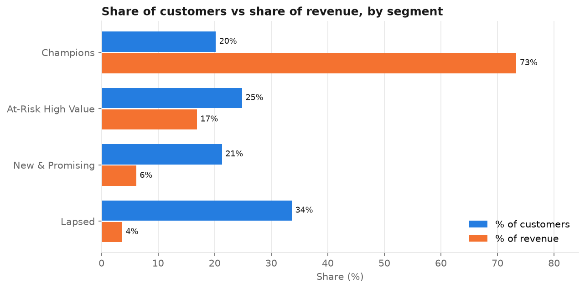
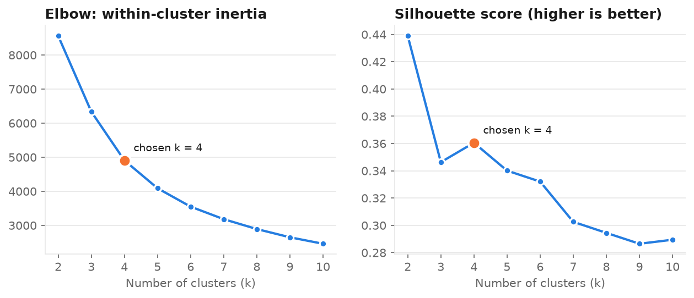
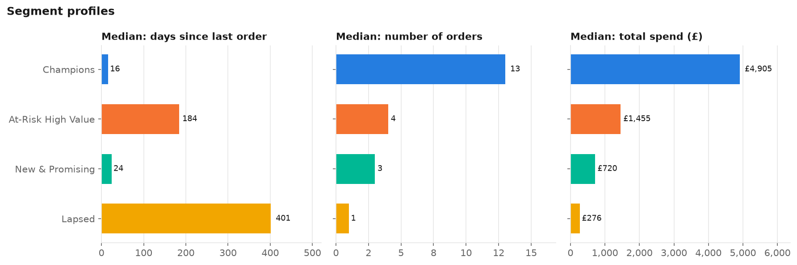
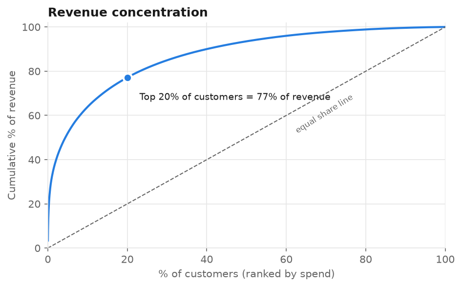
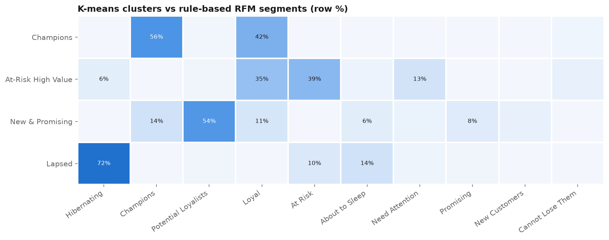

# Customer Segmentation for an Online Gift Retailer

*RFM scoring and k-means clustering on UCI Online Retail II. Generated 26 November 2026.*

## Business question
Which customers are worth the most, and how should marketing treat each group differently?

## Key findings
- **Revenue is concentrated.** The top 20% of customers generate 77% of revenue; the top 1% alone generate 32%.
- **Champions** are the most valuable group: 20% of customers but 73% of revenue. The median customer here has placed 13 orders, last bought 16 days ago and spent £4,905. Their revenue share is 3.6x their customer share, the highest of any segment.
- **£2,878,426 of historical revenue sits with At-Risk High Value** (1,455 customers, median 184 days since last order) - the clearest win-back opportunity.
- **Lapsed** are 34% of customers but only 4% of revenue - they should get the cheapest, most automated treatment.

## Data and cleaning
- 1,067,371 raw transaction lines, Dec 2009 to Dec 2011.
- Removed 34,335 duplicate lines, 235,151 lines with no Customer ID (cannot be segmented), 3,660 non-product lines (postage, fees, adjustments) and 60 lines with zero/negative quantity or price.
- 17,586 cancellation lines were set aside and used to compute each customer's return rate.
- Result: 776,579 lines, 36,594 invoices, **5,852 customers**.

## Method
1. **RFM table** - per customer: Recency (days since last order, measured from the day after the last transaction in the data), Frequency (number of distinct invoices) and Monetary (total net spend).
2. **RFM scores** - each metric split into quintiles (1-5), and customers mapped to the classic rule-based RFM segments as a benchmark.
3. **K-means** - R, F and M are log-transformed (they are heavily skewed) and standardised, then clustered for k = 2-10. **k = 4** was chosen as the best silhouette score between 3 and 6 (k = 2 is too coarse to act on; more than 6 is more programmes than a team can run).
4. **Profiling and naming** - clusters are ordered by median spend and named from their average R and F/M scores.

| k | Inertia | Silhouette | Davies-Bouldin |
|---|---|---|---|
| 2 | 8,562 | 0.439 | 0.874 |
| 3 | 6,338 | 0.346 | 1.037 |
| 4 **(chosen)** | 4,908 | 0.361 | 0.931 |
| 5 | 4,090 | 0.340 | 0.950 |
| 6 | 3,549 | 0.332 | 0.962 |
| 7 | 3,182 | 0.303 | 0.984 |
| 8 | 2,892 | 0.294 | 0.990 |
| 9 | 2,650 | 0.287 | 1.015 |
| 10 | 2,460 | 0.289 | 1.021 |

## Segment overview

| Segment | Customers | % customers | % revenue | Median days since order | Median orders | Median spend | Median order value | Return rate |
|---|---|---|---|---|---|---|---|---|
| Champions | 1,182 | 20.2% | 73.3% | 16 | 13 | £4,905 | £366 | 3.8% |
| At-Risk High Value | 1,455 | 24.9% | 16.9% | 184 | 4 | £1,455 | £321 | 5.9% |
| New & Promising | 1,246 | 21.3% | 6.1% | 24 | 3 | £720 | £255 | 1.8% |
| Lapsed | 1,969 | 33.6% | 3.7% | 401 | 1 | £276 | £200 | 2.3% |

## Segment profiles and targeting plan

### 1. Champions
**Size:** 1,182 customers (20%) - **Revenue:** £12,517,362 (73%), 3.6x their share of customers.

**Profile:** median 13 orders, last order 16 days ago, £4,905 total spend, £366 per order, customer for 678 days, 165 distinct products; 90% UK-based; 3.8% of value returned.

**Objective:** Retain and grow share of wallet; turn into advocates.

**Actions:**
- VIP tier: early access to new seasonal ranges (Christmas range launches in late summer for gift retailers).
- Volume-break pricing or free delivery thresholds instead of blanket discounts - these customers already buy without them.
- Dedicated account contact for wholesale buyers; referral incentive for other shops.
- Cross-sell complementary categories based on their purchase history.

**Channel:** Personal email / account manager, catalogue preview  
**Budget priority:** High - protect revenue, but avoid giving margin away with discounts  
**Measure success by:** Retention rate, revenue per customer, order frequency

### 2. At-Risk High Value
**Size:** 1,455 customers (25%) - **Revenue:** £2,878,426 (17%), 0.7x their share of customers.

**Profile:** median 4 orders, last order 184 days ago, £1,455 total spend, £321 per order, customer for 619 days, 64 distinct products; 90% UK-based; 5.9% of value returned.

**Objective:** Win back valuable customers before they are lost.

**Actions:**
- Personal win-back outreach ('we miss you') with a meaningful offer.
- Survey or call to find out why they stopped - price, range or service.
- Highlight new products added since their last order.

**Channel:** Personal email, phone for the largest accounts  
**Budget priority:** High per customer - recovering one is worth many new ones  
**Measure success by:** Reactivation rate, revenue recovered

### 3. New & Promising
**Size:** 1,246 customers (21%) - **Revenue:** £1,048,419 (6%), 0.3x their share of customers.

**Profile:** median 3 orders, last order 24 days ago, £720 total spend, £255 per order, customer for 218 days, 43 distinct products; 91% UK-based; 1.8% of value returned.

**Objective:** Convert a first or second order into a habit.

**Actions:**
- Onboarding email sequence: best-sellers, how to reorder, delivery info.
- Time-limited incentive on the second order (e.g. free delivery within 30 days).
- Ask for feedback after the first delivery to catch problems early.

**Channel:** Automated email journey  
**Budget priority:** Medium - the second order is the cheapest point to build loyalty  
**Measure success by:** Second-order conversion rate within 60/90 days

### 4. Lapsed
**Size:** 1,969 customers (34%) - **Revenue:** £624,376 (4%), 0.1x their share of customers.

**Profile:** median 1 orders, last order 401 days ago, £276 total spend, £200 per order, customer for 438 days, 17 distinct products; 93% UK-based; 2.3% of value returned.

**Objective:** Minimise spend; one last reactivation attempt.

**Actions:**
- One final win-back campaign with the strongest offer, then suppress from regular sends.
- Move to low-frequency list (major seasonal sales only) to protect email deliverability.
- Use as a lookalike exclusion set in paid acquisition.

**Channel:** Single email campaign, then suppression  
**Budget priority:** Minimal  
**Measure success by:** Reactivation rate vs campaign cost

## Validation against rule-based RFM
Each row shows where a k-means cluster's customers fall in the classic RFM grid. Clusters that map cleanly onto one or two RFM segments are behaving as expected; spread-out rows show where k-means draws different boundaries from fixed quintile rules.

## Limitations and next steps
- Customers without an ID (a large share of lines) are excluded, so this covers known/registered customers only.
- Many customers are wholesalers, so spend is skewed by a few very large accounts; a separate B2B/B2C split could sharpen the plan.
- RFM is backward-looking. A next step is a predictive model (e.g. BG/NBD + Gamma-Gamma for customer lifetime value, or a churn classifier) to rank customers on future value.
- Targeting actions should be tested with control groups before full rollout so uplift can be measured.
